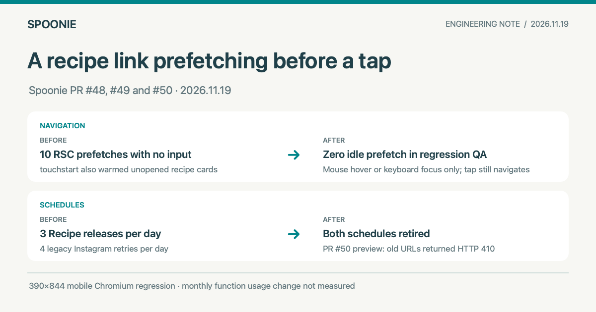

> 한국어판: [Spoonie가 레시피를 미리 불러오는 시점을 사용자 선택에 맞췄다](/spoonie-rsc-prefetch-20261119-ko/)

Scrolling a recipe list should not request the detail page for every card a reader passes. The merged Spoonie changes disable default navigation prefetch. Hover or keyboard focus warms the selected recipe; touch scrolling does not trigger a prefetch. [PR #48](https://github.com/saramjh/spoonie/pull/48) introduced intent-based prefetch, [PR #49](https://github.com/saramjh/spoonie/pull/49) removed `touchstart` from the intent signals, and [PR #50](https://github.com/saramjh/spoonie/pull/50) retired two legacy Netlify schedules.

## The request I reproduced

On November 18, Netlify's dashboard reported that Spoonie had exceeded its monthly allowance of 125,000 Functions. In a fresh 390×844 mobile Chromium session, I blocked service workers and made no pointer, keyboard, or touch input. The home page showed 40 recipe detail links and sent ten Next.js React Server Component (RSC) prefetch requests. Those requests included `/recipes`, `/search`, `/login`, `/`, and individual recipe routes.

The `___netlify-server-handler` duration logs recorded about 54 executions in two minutes. They contained no request path or client identifier, so they cannot show how many of those executions came from RSC prefetch.

<figure>
  
  <figcaption>RSC requests before the change and the navigation behavior afterward.</figcaption>
</figure>

## Navigation and scheduled functions

[PR #48](https://github.com/saramjh/spoonie/pull/48) set the shared `NavigationLink` default to `prefetch={false}`. The existing `IntentLink` prepares a destination after hover or keyboard focus. Its first version also treated touch start as intent.

On a phone, `touchstart` fires when a reader begins a swipe. That meant a scroll could request a recipe page the reader never opened. [PR #49](https://github.com/saramjh/spoonie/pull/49) removed `touchstart` from the prefetch signals. Hover and keyboard focus still prepare the selected destination, and tapping a recipe still opens its detail page.

[PR #50](https://github.com/saramjh/spoonie/pull/50) removed two old Netlify schedules: three queued Recipe releases per day and four legacy Instagram retries per day. The former `release-queued-recipes` and `retry-instagram-posts` handlers return HTTP 410 in the PR's Netlify Deploy Preview. The existing queue records remain in place; the change did not bulk-publish recipes or replay Instagram actions.

## Verification

The local production build after PR #48 recorded zero idle prefetches in its idle-state test. Hover warmed the selected destination, and clicking still navigated. PR #49 added checks for mobile touch start, swipe, and tap navigation.

PRs #48 and #49 passed 409 Vitest tests across 95 suites, plus six Node safety checks. TypeScript, touched-file ESLint, and the Next.js production build passed as well. PR #50 added 13 tests for the retired schedules and endpoint behavior. The latest attempts of all three Chromium workflows passed after their matching Netlify Deploy Previews were ready: [run 44244452809](https://github.com/saramjh/spoonie/actions/runs/44244452809), [run 44255793226](https://github.com/saramjh/spoonie/actions/runs/44255793226), and [run 44338009228](https://github.com/saramjh/spoonie/actions/runs/44338009228).

On November 19, the live [Spoonie home page](https://spoonie.kr/) and [search page](https://spoonie.kr/search) returned HTTP 200. In the PR #50 Netlify Deploy Preview, both retired function endpoints returned HTTP 410.

## Measurement limits

The ten idle requests came from one controlled browser session. Monthly Functions usage has not been compared after release, so quota recovery and monthly savings remain unknown. The retired endpoints returned HTTP 410 in the PR #50 Deploy Preview; production endpoint behavior remains unverified.

## Sources and related work

- [PR #48: disable default navigation prefetch](https://github.com/saramjh/spoonie/pull/48) · [merge commit](https://github.com/saramjh/spoonie/commit/fa9e4966ab3e016bf70033e16930dde1405c66a3)
- [PR #49: keep touch scrolling free of recipe prefetch](https://github.com/saramjh/spoonie/pull/49) · [merge commit](https://github.com/saramjh/spoonie/commit/a16d9521cf7e165a929cae76940a0298387beaed)
- [PR #50: retire legacy scheduled release and retry functions](https://github.com/saramjh/spoonie/pull/50) · [merge commit](https://github.com/saramjh/spoonie/commit/2160cdf35f54f3a64187e60ef3c44d2693c4c048)
- [Spoonie project case study](/portfolio/spoonie/)
- [PWA update checks and search-state recovery](/spoonie-pwa-search-state-recovery-en/)
- [Recipe search beyond the first page](/spoonie-search-discovery-en/)
- [Spoonie](https://spoonie.kr/)
