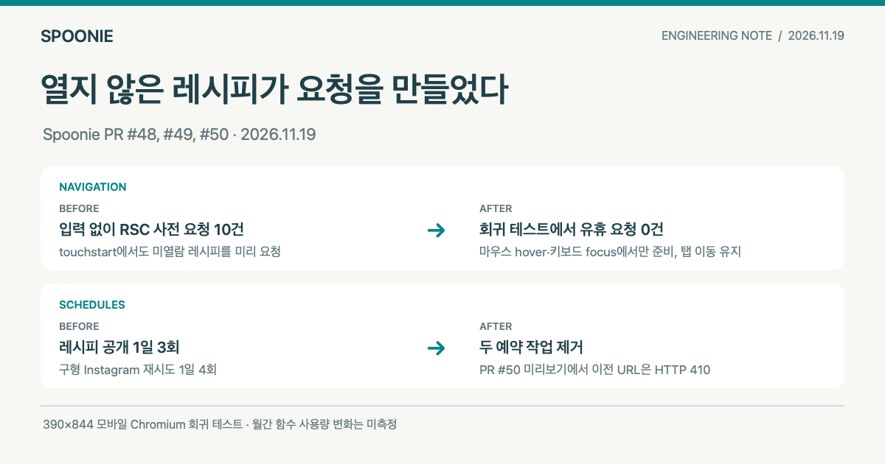

> English: [I made Spoonie wait until a reader chose a recipe](/spoonie-rsc-prefetch-20261119-en/)

레시피 목록을 스크롤할 때 지나치는 카드의 상세 페이지까지 미리 요청할 이유는 없다. 병합된 Spoonie 변경 사항은 공통 탐색 링크의 기본 사전 요청을 끈다. 마우스 hover나 키보드 focus로 선택 의도가 드러난 링크만 미리 준비하고, 터치 스크롤은 사전 요청을 발생시키지 않는다. [PR #48](https://github.com/saramjh/spoonie/pull/48)과 [PR #49](https://github.com/saramjh/spoonie/pull/49)가 탐색 동작을 바꿨고, [PR #50](https://github.com/saramjh/spoonie/pull/50)은 오래된 Netlify 예약 작업 두 개를 종료했다.

## 재현한 요청

11월 18일 Netlify 대시보드에서 월 125,000회 Functions 사용 한도 초과 알림을 확인했다. 새 390×844 모바일 Chromium 세션에서 서비스 워커를 차단하고 포인터, 키보드, 터치 입력 없이 Spoonie 홈을 열었다. 레시피 상세 링크 40개가 표시된 화면에서 Next.js React Server Component(RSC) 사전 요청 10건이 발생했다. 요청에는 `/recipes`, `/search`, `/login`, `/`와 개별 레시피 상세 경로가 포함됐다.

당시 `___netlify-server-handler` 실행 시간 로그는 2분 동안 약 54회를 기록했다. 로그에는 요청 경로나 클라이언트가 없어 이 54회를 모두 레시피 사전 요청으로 볼 근거는 없다. 브라우저에서 재현한 요청을 별도로 확인해 수정 대상으로 삼았다.

<figure>
  
  <figcaption>유휴 상태에서 발생한 요청과 사용자 입력에 반응하도록 바꾼 탐색 흐름.</figcaption>
</figure>

## 탐색 링크와 예약 작업 변경

[PR #48](https://github.com/saramjh/spoonie/pull/48)에서 공통 `NavigationLink`의 기본값을 `prefetch={false}`로 바꿨다. 기존 `IntentLink`는 마우스 hover, 키보드 focus, touchstart를 사전 요청 신호로 사용했다. 링크에 마우스를 올리거나 키보드로 포커스하면 목적지를 미리 준비하는 방식이었다.

모바일에서 touchstart는 스크롤을 시작할 때도 발생한다. 레시피를 열지 않고 카드를 스와이프해도 상세 페이지 요청이 시작될 수 있었다. [PR #49](https://github.com/saramjh/spoonie/pull/49)는 `touchstart`를 신호에서 제거했다. hover와 focus는 유지했고, 레시피를 탭하면 상세 화면으로 이동한다.

[PR #50](https://github.com/saramjh/spoonie/pull/50)은 Netlify의 오래된 예약 작업 두 개를 제거했다. 대기 중인 Recipe 공개 작업은 하루 3회, 구형 Instagram 재시도 작업은 하루 4회 실행되도록 설정돼 있었다. 기존 `release-queued-recipes`와 `retry-instagram-posts` 함수는 PR #50의 Netlify Deploy Preview에서 HTTP 410을 반환했다. 대기열 레코드는 보존했으며, 레시피 일괄 공개나 Instagram 재시도는 실행하지 않았다.

## 검증 결과

PR #48 적용 후 로컬 프로덕션 빌드의 유휴 상태 테스트에서는 사전 요청이 0건이었다. hover로 선택한 목적지를 준비한 뒤 클릭하면 정상적으로 이동했다. PR #49는 모바일 touchstart, swipe, tap 동작을 회귀 테스트에 추가했다.

PR #48과 #49에서는 95개 스위트의 Vitest 409건과 별도 Node 안전성 검사 6건이 통과했다. TypeScript, 변경 파일 ESLint, Next.js 프로덕션 빌드도 통과했다. PR #50에는 예약 설정과 종료된 함수 동작을 확인하는 테스트 13건을 추가했다. 세 Chromium 워크플로는 각각의 Netlify Deploy Preview가 준비된 뒤 브라우저 검증을 통과했다([실행 44244452809](https://github.com/saramjh/spoonie/actions/runs/44244452809), [실행 44255793226](https://github.com/saramjh/spoonie/actions/runs/44255793226), [실행 44338009228](https://github.com/saramjh/spoonie/actions/runs/44338009228)).

11월 19일 운영 환경에서 [Spoonie 홈](https://spoonie.kr/)과 [검색 페이지](https://spoonie.kr/search)는 HTTP 200을 반환했다. PR #50의 Netlify Deploy Preview에서는 제거한 두 함수 주소가 HTTP 410을 반환했다.

## 측정 범위

유휴 요청 10건은 통제된 브라우저 세션 한 번에서 관측했다. 배포 후 월간 Functions 사용량은 아직 비교하지 않았다. 따라서 한도 초과 해소 여부와 월간 절감량은 확인되지 않았다. 폐기 함수의 HTTP 410 응답은 PR #50의 Netlify Deploy Preview에서만 확인했다.

## 원본 자료와 관련 작업

- [PR #48: 공통 탐색의 기본 사전 요청 비활성화](https://github.com/saramjh/spoonie/pull/48) · [병합 커밋](https://github.com/saramjh/spoonie/commit/fa9e4966ab3e016bf70033e16930dde1405c66a3)
- [PR #49: 터치 스크롤 중 레시피 사전 요청 제거](https://github.com/saramjh/spoonie/pull/49) · [병합 커밋](https://github.com/saramjh/spoonie/commit/a16d9521cf7e165a929cae76940a0298387beaed)
- [PR #50: 기존 예약 공개 및 재시도 함수 종료](https://github.com/saramjh/spoonie/pull/50) · [병합 커밋](https://github.com/saramjh/spoonie/commit/2160cdf35f54f3a64187e60ef3c44d2693c4c048)
- [Spoonie 프로젝트 사례](/portfolio/spoonie/)
- [PWA 업데이트 확인과 검색 상태 복원](/spoonie-pwa-search-state-recovery-ko/)
- [첫 페이지 이후 레시피 검색](/spoonie-search-discovery-ko/)
- [Spoonie](https://spoonie.kr/)
