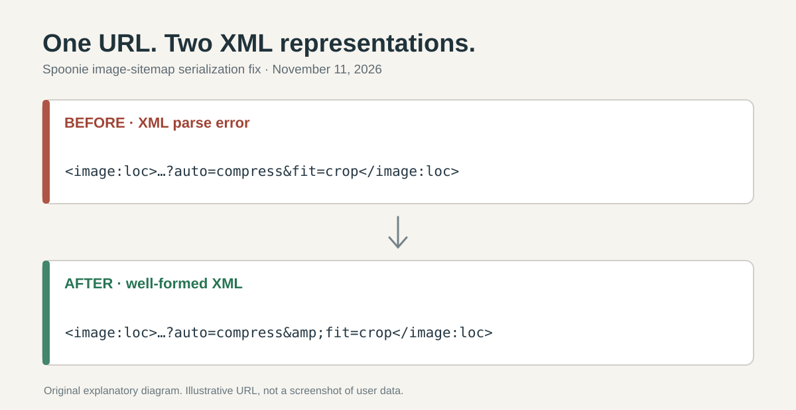

> 한국어판: [Spoonie 사이트맵 XML 오류: 이미지 URL의 &를 수정한 이유](/spoonie-sitemap-xml-image-escaping-ko/)

**I fixed a Spoonie image sitemap that standard XML parsers could not read.** An image URL with query parameters was written into `image:loc` without escaping its ampersands. [PR #29](https://github.com/saramjh/spoonie/pull/29) merged on November 11, 2026. I also fetched and parsed the [production sitemap](https://spoonie.kr/sitemap.xml) after the merge.

## A valid image URL became invalid XML

An image URL such as `?auto=compress&fit=crop&w=1280` is fine as a URL. But within XML element text, `&` must be represented as `&amp;`. In Spoonie's particular sitemap serialization path with **Next.js 16.4.2**, that escaping was missing for image URL values. The image was not the problem. The XML output was.

<figure>
  
  <figcaption>An illustrative URL and an original diagram, not a production image or user record.</figcaption>
</figure>

```xml
<!-- Before -->
<image:loc>https://images.example/food.jpg?auto=compress&fit=crop</image:loc>

<!-- After -->
<image:loc>https://images.example/food.jpg?auto=compress&amp;fit=crop</image:loc>
```

## The change stayed at the output boundary

I updated the existing `uniqueImages()` helper in `src/app/sitemap.ts` to escape `&`, `<` and `>` before the image URLs reach the sitemap output. Recipes and Recipeed records already share that helper. I did not rewrite stored image URLs, change recipe data or replace the sitemap generator.

The [regression test in the merged commit](https://github.com/saramjh/spoonie/blob/360d0eb048d7d775048a71d58003a5e7a4e0bb37/src/app/sitemap-xml-escaping.test.ts) supplies an image query string, calls Next.js `resolveSitemap()`, and checks the resulting XML for `&amp;`. This proves the demonstrated serialization problem is covered by a test, not that every possible crawler outcome has been verified.

## Production readback

At **23:29 KST on November 11, 2026**, the [live sitemap](https://spoonie.kr/sitemap.xml) returned HTTP 200 and passed Python's `xml.etree.ElementTree` parser. At that moment the document contained **689 `<url>` entries**, **872 `<image:loc>` entries** and **four `&amp;` entity strings**. Those counts are a snapshot, not a permanent catalogue size.

[Google's Search Console guidance](https://support.google.com/webmasters/answer/7451001) identifies unescaped URL characters as a common sitemap parsing problem. Passing an XML parser establishes that the deployed document is well-formed. It **does not establish indexing, improved search impressions or user growth**.

The [source PR](https://github.com/saramjh/spoonie/pull/29), [Next.js sitemap reference](https://nextjs.org/docs/app/api-reference/file-conventions/metadata/sitemap) and [my English note on Spoonie's first-record problem](/spoonie-disquiet-first-record-en/) provide the code and product context.
