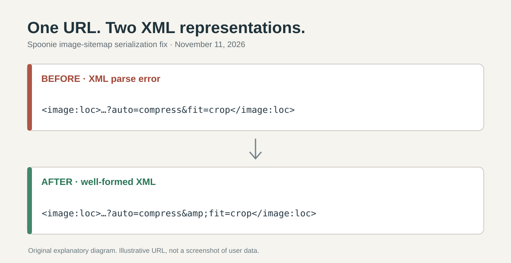

> English version: [How I fixed an image sitemap XML parse error in Spoonie](/spoonie-sitemap-xml-image-escaping-en/)

**Spoonie의 이미지 사이트맵이 표준 XML 파서에서 실패하던 문제를 고쳤다.** 레시피 이미지 주소의 쿼리 문자열에 들어 있는 `&` 문자가 `image:loc` XML 요소에 이스케이프되지 않은 채 출력되는 것이 원인이었다. [원본 수정 PR #29](https://github.com/saramjh/spoonie/pull/29)는 2026년 11월 11일 병합됐다. 같은 날 별도로 [운영 사이트맵](https://spoonie.kr/sitemap.xml)을 내려받아 XML 파서로 확인했다.

## 이미지 URL은 정상이지만 XML 표현이 잘못됐다

이미지 주소에는 `?auto=compress&fit=crop&w=1280`처럼 매개변수가 이어질 수 있다. URL에서는 문제가 없지만 XML 요소의 텍스트에서는 특수문자 `&`를 `&amp;`로 표현해야 한다. 당시 Spoonie에서 사용한 **Next.js 16.4.2 사이트맵 직렬화 경로**는 이미지 URL의 이 부분을 이스케이프하지 않았다.

<figure>
  
  <figcaption>설명을 위해 만든 예시 URL이다. 실제 사용자 이미지나 제3자의 화면을 복사하지 않았다.</figcaption>
</figure>

```xml
<!-- 수정 전 -->
<image:loc>https://images.example/food.jpg?auto=compress&fit=crop</image:loc>

<!-- 수정 후 -->
<image:loc>https://images.example/food.jpg?auto=compress&amp;fit=crop</image:loc>
```

## 저장 데이터가 아닌 출력 경계에서 수정

기존 `src/app/sitemap.ts`의 `uniqueImages()`에서 이미지 URL을 직렬화하기 전에 `&`, `<`, `>`를 XML 엔티티로 바꾸는 코드를 추가했다. Recipe와 Recipeed가 같은 이미지 수집 경로를 사용하므로 중복 함수를 만들 필요는 없었다. 원본 이미지 URL이나 레시피 데이터, 라우팅을 변경하지 않았다.

[실제 회귀 테스트](https://github.com/saramjh/spoonie/blob/360d0eb048d7d775048a71d58003a5e7a4e0bb37/src/app/sitemap-xml-escaping.test.ts)는 이미지 쿼리 문자열을 주입하고, Next.js `resolveSitemap()`이 만든 XML 결과에서 `&amp;`를 확인한다. 검색엔진이 수집한 결과는 이 테스트에서 검증하지 않는다.

## 운영 결과와 측정의 한계

2026년 11월 11일 **23시 29분 KST**, [공개 사이트맵](https://spoonie.kr/sitemap.xml)은 HTTP 200을 반환했고 Python `xml.etree.ElementTree`로 정상 파싱됐다. 당시 결과에는 **`<url>` 689개**, **`<image:loc>` 872개**, XML 원문의 **`&amp;` 표기 4개**가 있었다. 페이지와 이미지 수는 시점에 따라 바뀔 수 있다.

[Google Search Console의 사이트맵 오류 설명](https://support.google.com/webmasters/answer/7451001)에도 이스케이프되지 않은 특수문자로 인한 파싱 오류가 명시돼 있다. 이번 수정으로 **문서가 유효한 XML임은 검증했지만 Google 색인 증가나 검색 유입 증가까지 확인된 것은 아니다.**

원본 코드는 [Spoonie PR #29](https://github.com/saramjh/spoonie/pull/29), 메타데이터 규약은 [Next.js 공식 사이트맵 문서](https://nextjs.org/docs/app/api-reference/file-conventions/metadata/sitemap), 제품 맥락은 [Spoonie Recipe·Recipeed 개발 기록](/spoonie-social-cooking-early-users/)에서 확인할 수 있다.
