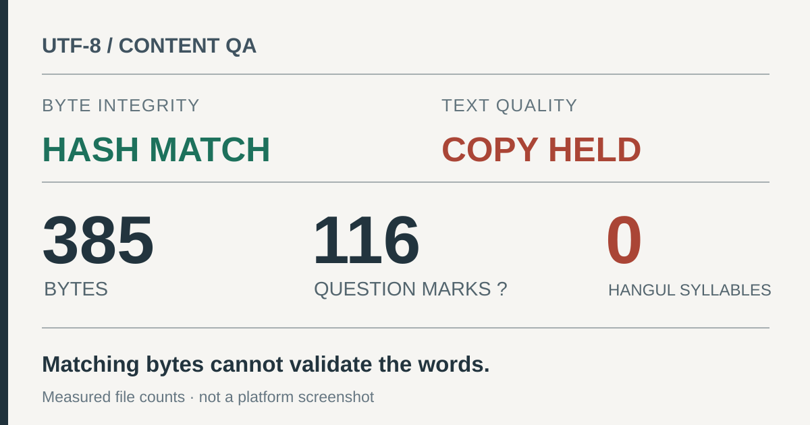

> 한국어판: [SHA-256은 일치했지만 한글 문안은 물음표로 바뀌었다](/utf8-caption-hash-is-not-text-quality-ko/)

**A matching SHA-256 confirms that some bytes match a reference. It does not confirm the writer's words survived.** I ran into that distinction while checking a Korean-language caption prepared for a social post.

The file contained **385 bytes**, including **116 literal question marks** and **zero Hangul syllables**. Every byte was ASCII, and its SHA-256 matched the stored asset hash. I withdrew the local publication candidate. That check does not establish when the text was damaged or what, if anything, happened on a separate publishing platform.

<figure>
  <a href="/assets/img/dev-utf8-caption-integrity-20261110/audit-en.svg"></a>
  <figcaption>Reconstructed from the measured file, not a screenshot of the platform or the moment the text was lost.</figcaption>
</figure>

## Two different tests

SHA-256 measures the bytes supplied to it. That is useful for detecting changes during storage or transfer. But if a file was already damaged when its reference hash was calculated, a perfect match only certifies those **same damaged bytes**.

The symptom here was not `�` (U+FFFD), the Unicode replacement character. It was the ordinary ASCII question mark, `?`. A strict UTF-8 decoder accepts an ASCII-only file. So successful UTF-8 decoding is necessary for many workflows, but it does not prove the Korean source text remains intact.

## Reproduce a failure mode, not the incident's cause

One possible route to similar output is ASCII encoding with character replacement:

```python
source = "한글 문안"
corrupted = source.encode("ascii", errors="replace")
assert corrupted == b"?? ??"
assert corrupted.decode("utf-8", errors="strict") == "?? ??"
```

This is a controlled example, **not a root-cause finding** for the original file. It demonstrates how information can be lost while the resulting bytes still pass UTF-8 decoding. Python documents the `?` substitution in its [codec error handlers](https://docs.python.org/3/library/codecs.html) and SHA-256's byte-based interface in [hashlib](https://docs.python.org/3/library/hashlib.html).

## Add a language-aware gate

For an asset explicitly designated as a Korean caption, check for expected text separately from the digest:

```python
from pathlib import Path
import hashlib
import re

payload = Path("caption.txt").read_bytes()
text = payload.decode("utf-8", errors="strict")

if "\ufffd" in text:
    raise ValueError("Unicode replacement character found")
if not re.search(r"[\uac00-\ud7a3]", text):
    raise ValueError("Expected Korean copy; found no Hangul")

digest = hashlib.sha256(payload).hexdigest()
print(digest)  # Separate byte-integrity check
```

The language condition matters. An English-only caption should not fail for containing no Hangul; a partly damaged Korean caption might still contain a few. Production review needs a source text to compare against, the appropriate language expectations and a read of the final rendered copy. **A character count or hash is not editorial approval.**

## What remains unknown

Question marks alone cannot reconstruct the missing Hangul. The inspected file does not identify the application or conversion step that replaced the characters. Nor does a local asset audit establish a platform publication outcome.

In an [earlier portfolio regression note](/portfolio-evidence-release-qa-en/), a browser test failed after the number of evidence entries changed. This time, the weak point was in the content pipeline: the deterministic file fingerprint passed even though the words had already disappeared.
