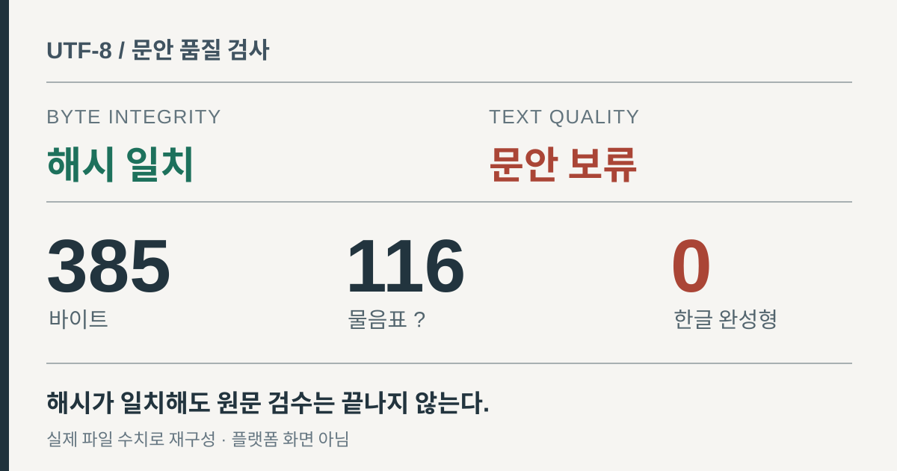

> English version: [The hash matched. The Korean caption was already broken.](/utf8-caption-hash-is-not-text-quality-en/)

**SHA-256이 일치한다는 것은 바이트가 기준과 같다는 뜻이지, 파일에 담긴 문장이 온전하다는 뜻은 아니다.** 한글 소셜 게시 문안을 검토하면서 그 차이를 확인했다.

파일은 **385바이트**였다. 물음표 `?`는 **116개**, 한글 완성형 글자는 **0개**였다. 모든 바이트가 ASCII 범위였고, 직접 계산한 SHA-256은 기록된 파일 해시와 일치했다. 로컬 게시 후보는 철회했다. 이 사실만으로 오류가 발생한 단계나 플랫폼에 게시됐는지까지 알 수는 없다.

<figure>
  <a href="/assets/img/dev-utf8-caption-integrity-20261110/audit-ko.svg"></a>
  <figcaption>원본 파일의 검증 수치로 만든 도해다. 실제 소셜 미디어 화면이나 오류 발생 과정을 촬영한 이미지는 아니다.</figcaption>
</figure>

## 해시가 증명하는 범위

SHA-256은 주어진 바이트의 지문을 계산한다. 파일이 저장 또는 전송되는 동안 달라졌는지 확인하는 데 유용하다. 하지만 **이미 손상된 파일을 기준으로 해시를 만들었다면**, 이후 해시가 맞아도 원문이 복구되는 것은 아니다.

이번 파일에는 `�`(U+FFFD)이 없었다. 문제가 된 자리는 일반 ASCII 물음표 `?`로 채워져 있었다. 따라서 엄격한 UTF-8 디코딩도 통과한다. ASCII는 유효한 UTF-8의 일부이기 때문이다. **유효하게 디코딩되는 파일**과 **원문이 남아 있는 파일**은 구별해야 한다.

## 가능한 손상 경로를 별도로 재현했다

다음 코드는 발견한 오류의 원인이라고 주장하는 것이 아니다. 한글을 ASCII로 인코딩하면서 `errors="replace"`를 지정하면 비ASCII 문자가 `?`로 대체되는 과정을 보여 주는 재현 예제다.

```python
source = "한글 문안"
corrupted = source.encode("ascii", errors="replace")
assert corrupted == b"?? ??"
assert corrupted.decode("utf-8", errors="strict") == "?? ??"
```

실제 파일이 바로 이 경로로 만들어졌다는 증거는 없다. 확인 가능한 것은 **원문 정보가 사라진 뒤에도 파일 자체는 올바른 UTF-8로 읽힐 수 있다는 점**이다. Python의 [코덱 오류 처리 문서](https://docs.python.org/3/library/codecs.html)는 인코딩 대체 동작을, [hashlib 문서](https://docs.python.org/3/library/hashlib.html)는 바이트 기반 SHA-256 계산을 설명한다.

## 게시 전에 추가할 검사

한글 본문이 반드시 들어가야 하는 자산이라면 해시 확인과 별도로, 예상 언어가 실제로 포함됐는지 검사할 수 있다.

```python
from pathlib import Path
import hashlib
import re

payload = Path("caption.txt").read_bytes()
text = payload.decode("utf-8", errors="strict")

if "\ufffd" in text:
    raise ValueError("문자 대체 기호 발견")
if not re.search(r"[\uac00-\ud7a3]", text):
    raise ValueError("한글 문안으로 지정됐지만 한글이 없음")

digest = hashlib.sha256(payload).hexdigest()
print(digest)  # 별도의 바이트 무결성 검사
```

이 코드는 보편적인 문안 검사기가 아니다. 영문만 있는 정상 파일에 적용하면 잘못 보류할 수 있고, 한글이 조금 남아 있는 부분 손상은 놓칠 수 있다. 언어별 기대 조건, 승인된 원문과의 대조, 실제 렌더된 문안 확인이 함께 필요하다. **문자 수 제한을 통과한 것만으로 게시 준비가 끝나지 않는다.**

## 남은 불확실성

물음표만으로 사라진 한글을 복원할 수 없다. 어떤 프로그램이나 입출력 단계가 문자를 대체했는지도 이 파일만으로는 확인하지 못했다. 로컬 자산 검사는 소셜 플랫폼의 발행 영수증도 아니다.

앞서 [포트폴리오 브라우저 회귀 검사를 다룬 개발일지](/portfolio-evidence-release-qa-ko/)는 증빙 항목 수가 늘어나 선택자 테스트가 실패한 사례다. 이번 사례는 다른 경계다. **바이트 무결성 검증과 읽을 수 있는 글의 검수는 별개의 일**이라는 점이다.
