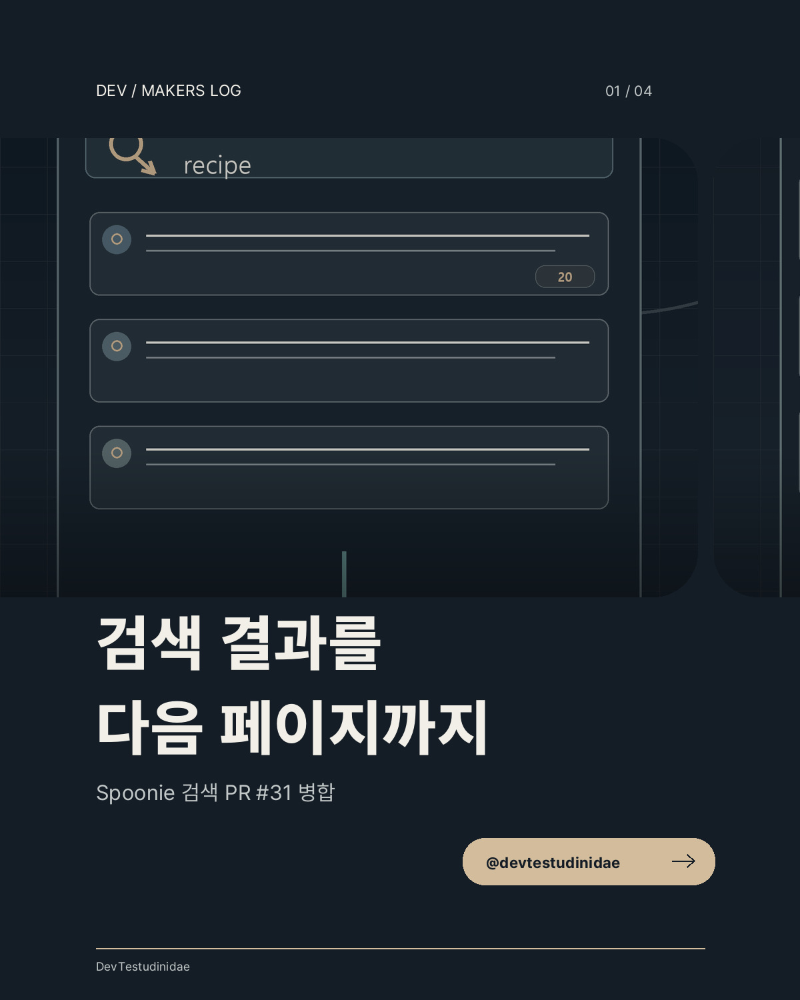
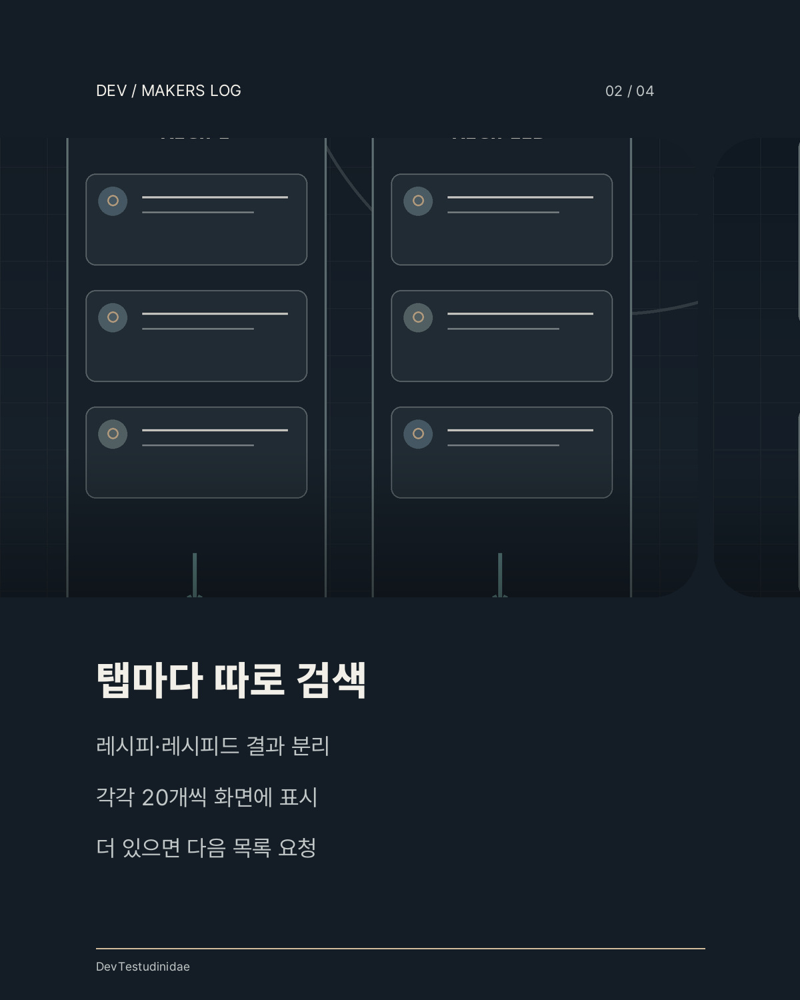
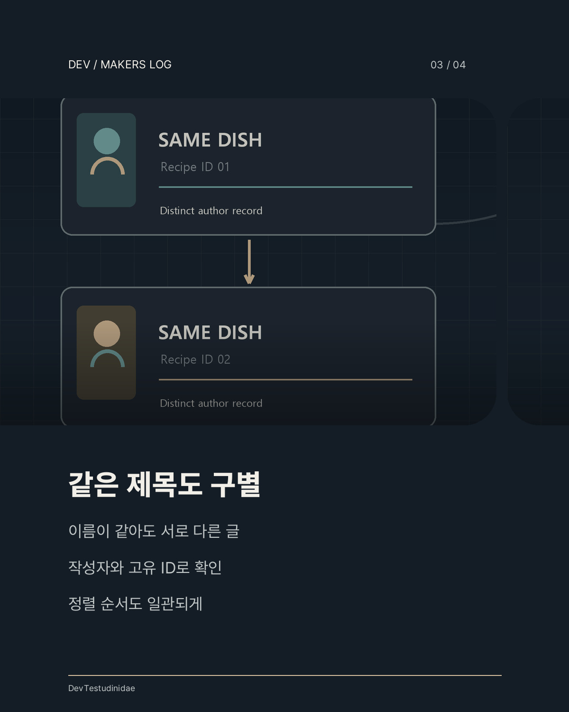
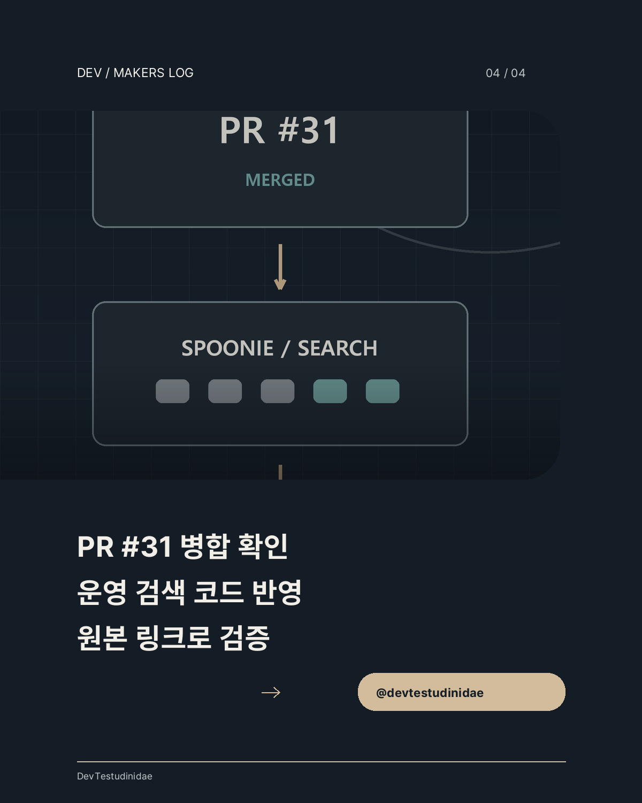

# Spoonie search PR #31: original media

I drew these four diagrams to explain the search changes in [Spoonie PR #31](https://github.com/saramjh/spoonie/pull/31). They are editorial illustrations, not screenshots of real search results or measured usage.

레시피·레시피드 검색 기능을 설명하기 위해 직접 제작한 카드 이미지 4장입니다. 실제 사용자 화면을 캡처하거나 실사용 통계를 시각화한 자료가 아닙니다.

The merged source is described in the [English engineering note](/spoonie-search-discovery-en/) and [Korean case](/spoonie-search-discovery-ko/). The [public Spoonie search page](https://spoonie.kr/search) serves the changed client search code. Real usage outcomes are not measured here.

<figure>
  
  <figcaption>Card 1 of 4. Original DevTestudinidae illustration of the verified source change.</figcaption>
</figure>

<figure>
  
  <figcaption>Card 2 of 4. Original DevTestudinidae illustration of the verified source change.</figcaption>
</figure>

<figure>
  
  <figcaption>Card 3 of 4. Original DevTestudinidae illustration of the verified source change.</figcaption>
</figure>

<figure>
  
  <figcaption>Card 4 of 4. Original DevTestudinidae illustration of the verified source change.</figcaption>
</figure>
